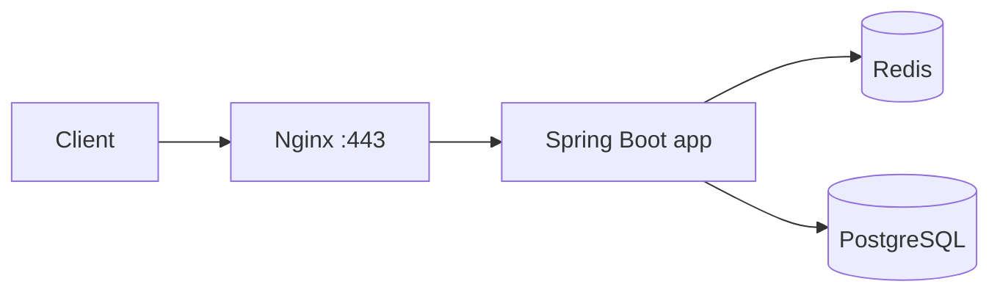

# URL Shortener

A URL shortener with user accounts, built to practice the pieces a real backend
service needs: authentication, caching, rate limiting, tests, containers, CI and
a reverse proxy with TLS.

## Features
- Register and log in (BCrypt password hashing, JWT access tokens)
- Create short links, list your own links (paginated), delete them
- Redirect by short code (HTTP 302), with a Redis cache
- IP-based rate limiting on write endpoints (30 requests per minute)

## Architecture



## Tech stack
Java 21, Spring Boot, Spring Security, Spring Data JPA, PostgreSQL, Flyway,
Redis, JUnit 5, Mockito, Testcontainers, Docker, GitHub Actions, Nginx.

## Run locally
```bash
echo "JWT_SECRET=$(openssl rand -base64 48 | tr -d '\n')" > .env
echo "POSTGRES_PASSWORD=$(openssl rand -hex 16)" >> .env
docker compose up -d --build
./smoke-test.sh
```

## API
| Method | Path | Auth |
|---|---|---|
| POST | /api/auth/register | no |
| POST | /api/auth/login | no |
| POST | /api/links | yes |
| GET | /api/links | yes |
| DELETE | /api/links/{code} | yes (owner only) |
| GET | /{code} | no (302 redirect) |

## Design decisions
- **Unique index instead of "check then insert".** Two requests can pick the same
  code at the same time, so the database decides. On a collision the service
  retries with a new code.
- **302, not 301.** A 301 is cached by browsers, so later clicks would never
  reach the server.
- **Cache-aside with Redis.** Redirects are read far more often than links are
  written. If Redis is down, requests fall back to the database.
- **404 instead of 403 when deleting someone else's link.** A 403 would reveal
  that the link exists.
- **Same error for unknown email and wrong password**, so the API does not leak
  which emails are registered.
- **The server pulls a prebuilt image.** CI tests and builds the image once; the
  server only runs it.

## Testing
Unit tests use Mockito. Integration tests run against real PostgreSQL and Redis
containers via Testcontainers.

## CI/CD and deployment
GitHub Actions runs the tests on every push. On `main` it also builds the image
and pushes it to GitHub Container Registry. On the server, `deploy.sh` pulls the
image and restarts the app; Nginx terminates TLS (self-signed certificate).
Deployed on a local Ubuntu VM (Multipass), not on a public server.

## Known limitations
- No refresh tokens; a JWT cannot be revoked before it expires
- Fixed-window rate limiter
- Unknown short codes are not cached
- Deployment is manual and there is a short gap while the container restarts